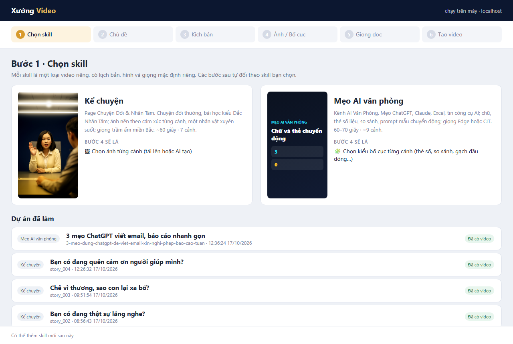

# Xưởng Video

Web app chạy trên máy để làm video dọc 9:16 không cần gõ lệnh. Đi qua 6 bước:
**Chọn skill → Chủ đề → Kịch bản → Ảnh / Bố cục → Giọng đọc → Tạo video**.

App không thay thế các skill mà điều khiển chúng: mỗi dự án chính là file `videos/<id>.json` trong
thư mục làm việc của skill, nên video làm trên app vẫn mở và sửa tiếp được bằng Claude Code trong chat,
và ngược lại.



## Mở app

Bấm đúp `start-xuong-video.bat`: cửa sổ dòng lệnh mở máy chủ, trình duyệt tự mở
`http://127.0.0.1:5170`. Giữ cửa sổ dòng lệnh mở trong lúc dùng; đóng nó là tắt app.

Hoặc trong thư mục này:

```bash
npm start
```

Lần đầu trên máy mới: chạy `npm install` trước.

## Cần có

- **Node.js 20** và **Python 3** (có `edge-tts`), **ffmpeg** trong PATH.
- **Claude Code** đã đăng nhập (lệnh `claude`): app dùng nó để viết kịch bản, tính vào hạn mức gói Claude.
  Mỗi lần viết mất khoảng 1–2 phút.
- **CIT Voice Studio** đang mở nếu dùng giọng CIT (`http://127.0.0.1:8001`). Không mở thì vẫn dùng được giọng Edge.
- Thư mục làm việc của từng skill đã cài thư viện (`npm install`) và có `.env` chứa khóa tạo ảnh
  (skill Kể chuyện: Cloudflare hoặc OpenAI). Gói Cloudflare miễn phí đủ khoảng 10 ảnh mỗi ngày.

## Hai skill có sẵn

| Skill | Thư mục làm việc | Bước 4 |
|---|---|---|
| Kể chuyện (Chuyện Đời & Nhân Tâm) | `D:\ke-chuyen-video` | Ảnh nền từng cảnh: tải lên hoặc AI tạo |
| Mẹo AI văn phòng | `C:\Users\admin\ai-van-phong-video` | Kiểu bố cục từng cảnh và chữ trên màn hình |

Video, ảnh bìa và caption được lưu trong thư mục `out/` của skill:

- Kể chuyện: `out/<id>/video_<id>.mp4`, `thumbnail_<id>.png`, `facebook_caption.txt`
- Mẹo văn phòng: `out/<id>.mp4`, `out/<id>.txt`

Bước 6 có nút tải từng file.

## Mẹo dùng

- App tự lưu mọi chỉnh sửa. Danh sách "Dự án đã làm" ở bước 1 mở lại dự án cũ.
- Link dạng `http://127.0.0.1:5170/#ke-chuyen-video/story_004/3` mở thẳng một dự án ở một bước.
- Đóng tab khi đang tạo video không làm dừng việc tạo; mở lại trang để xem tiến độ.
- Mỗi lúc chỉ tạo được một video (CIT Voice Studio xử lý từng yêu cầu một).
- Khi tạo lại một ảnh mà AI lỗi (ví dụ hết hạn mức), ảnh cũ được giữ nguyên.
- Không dùng khóa API: ở bước Ảnh bấm **📋 Prompt cho ChatGPT** để sao chép một prompt tạo đủ mọi ảnh,
  dán vào ChatGPT hoặc Gemini (gói bạn đang trả), rồi tải từng ảnh lên thẻ cùng tên.
- Khi kịch bản vượt giới hạn của skill, app báo đúng cảnh và trường cần sửa.

## Thêm skill mới

1. Thêm một mục vào `skills.json`: `id`, `name`, `description`, `kind`, `workspace`, `skillDir`,
   `wordsPerMinute`, `defaultVoice`, `step4` (`images` hoặc `layouts`), `sampleImage`.
2. Nếu skill dùng định dạng JSON giống một trong hai loại có sẵn, đặt `kind` là `story` hoặc `office` là xong.
3. Nếu định dạng khác: thêm bộ chuyển đổi `src/kinds/<kind>.js` (cùng các hàm như `story.js`), lời nhắc
   `src/prompts/<kind>.md`, chuỗi lệnh trong `src/pipelines.js`, rồi đăng ký trong `src/kinds/index.js`.

## Kiểm thử

```bash
npm test
```
